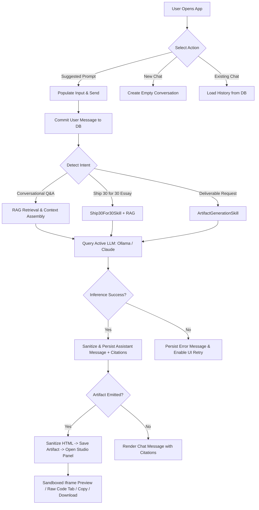

# Product Requirements Document (PRD)

## Project Name: The Lenny Growth Assistant
**Document Version:** 1.0.0  
**Target Release:** 1.0.0  
**Status:** Completed (Steps 1–11 Implemented; Step 12 Documented)  

---

## 1. Executive Summary & Product Vision

**The Lenny Growth Assistant** is an intelligent, full-stack conversational application built for product managers, growth leaders, and founders. It bridges the gap between unstructured industry wisdom and tactical execution by synthesizing actionable insights from genuine **Lenny's Podcast** transcripts.

Unlike generic chatbot wrappers, The Lenny Growth Assistant provides:
1. **Strictly Grounded Insights**: Answers are anchored in verified podcast interview transcripts, complete with speaker attribution, guest insights, and deep-linked YouTube video timestamps.
2. **Ship 30 for 30 Atomic Growth Essays**: A specialized agent skill that synthesizes long-form (~1,250 words) actionable growth essays structured with clear thesis statements, modular frameworks, tactical playbooks, and transparent word-count validation.
3. **Interactive Artifact Studio**: A split-screen studio panel that generates, sanitizes, and renders live HTML/CSS landing pages, interactive UI widgets, and structured Markdown guides with sandboxed iframe preview, syntax inspection, and one-click export (Copy / Download).
4. **Dual Local & Cloud Inference**: Zero-cost, privacy-first local inference using **Ollama** (`llama3.2:3b`) as default, with seamless optional configuration for **Anthropic Claude** (`claude-3-5-sonnet-20241022`).
5. **Production-Ready Persistence**: PostgreSQL persistence for conversation history, messages, rich artifacts, and vector knowledge chunks with foreign-key cascade deletion.

---

## 2. Intended Users & Target Personas

### Persona A: The Product Manager (PM)
- **Role**: Senior or Group Product Manager at a B2B SaaS or consumer tech company.
- **Goal**: Rapidly benchmark metrics, define retention loops, or construct customer onboarding flows using proven playbooks from industry leaders.
- **Pain Point**: Sifting through hundreds of hours of podcasts to find specific tactical advice (e.g., Todd Jackson's PMF framework or Elena Verna's B2B growth loops).

### Persona B: The Startup Founder / Operator
- **Role**: Early-stage founder or Head of Growth.
- **Goal**: Draft go-to-market strategies, landing page copy, or growth playbooks to align their team.
- **Pain Point**: Needs structured, comprehensive long-form writing (essays, landing page wireframes) rather than shallow conversational snippets.

---

## 3. Product Scope: Implemented vs. Planned Features

| Feature Category | Feature Description | Status in v1.0.0 | Implementation Reference |
|---|---|---|---|
| **Conversational Core** | Multi-turn chat with conversation history and PostgreSQL persistence | **Implemented** | [`backend/app/api/conversations.py`](file:///d:/oogway/lenny%20growth%20assistant/lenny-growth-assistant/backend/app/api/conversations.py) |
| **RAG Knowledge Base** | Vector indexing and retrieval of Lenny's Podcast transcripts with cosine similarity | **Implemented** | [`backend/app/knowledge_base/`](file:///d:/oogway/lenny%20growth%20assistant/lenny-growth-assistant/backend/app/knowledge_base/) |
| **Source Citations** | Clickable YouTube citations with calculated timestamp deep links (`&t=Xs`) | **Implemented** | [`backend/app/agents/rag_agent.py`](file:///d:/oogway/lenny%20growth%20assistant/lenny-growth-assistant/backend/app/agents/rag_agent.py) |
| **Ship 30 for 30 Skill** | ~1,250-word atomic essay generation with controlled continuation and word count reporting | **Implemented** | [`backend/app/skills/ship_30_for_30.py`](file:///d:/oogway/lenny%20growth%20assistant/lenny-growth-assistant/backend/app/skills/ship_30_for_30.py) |
| **Artifact Studio** | Side-by-side Markdown & HTML/CSS generation, copy to clipboard, file download | **Implemented** | [`frontend/src/components/ArtifactPanel.jsx`](file:///d:/oogway/lenny%20growth%20assistant/lenny-growth-assistant/frontend/src/components/ArtifactPanel.jsx) |
| **Security Sandbox** | Backend HTML sanitizer (`sanitizer.py`) + Frontend `iframe sandbox=""` | **Implemented** | [`backend/app/core/sanitizer.py`](file:///d:/oogway/lenny%20growth%20assistant/lenny-growth-assistant/backend/app/core/sanitizer.py) |
| **Dual LLM Support** | Local Ollama (`llama3.2:3b`) default + Anthropic Claude cloud option | **Implemented** | [`backend/app/agents/providers/`](file:///d:/oogway/lenny%20growth%20assistant/lenny-growth-assistant/backend/app/agents/providers/) |
| **Reliability & Health** | System probes (`/health`, `/health/db`, `/health/llm`), user message preservation, UI retry | **Implemented** | [`backend/app/api/health.py`](file:///d:/oogway/lenny%20growth%20assistant/lenny-growth-assistant/backend/app/api/health.py) |
| **Deployment** | Multi-stage Docker Compose setup with persistent PostgreSQL volume | **Implemented** | [`docker-compose.yml`](file:///d:/oogway/lenny%20growth%20assistant/lenny-growth-assistant/docker-compose.yml) |
| **Transcripts Ingested** | 6 genuine episodes (922 chunks) in DB; 303 episodes discovered in repo | **Partially Implemented** | Full batch CLI tool ready; 6 active in DB |
| **Streaming Responses** | Token-by-token streaming via Server-Sent Events (SSE) | **Planned (Post-v1)** | Full response returned asynchronously |
| **User Authentication** | Multi-user JWT tenancy, login, and team workspaces | **Planned (Post-v1)** | Single-tenant local workspace in v1.0 |

---

## 4. Functional Requirements

### 4.1. Conversational Q&A & Persistence (FR-1)
- **FR-1.1**: The system must allow users to create new conversations via `POST /api/conversations`.
- **FR-1.2**: All user prompts and assistant replies must be saved in the PostgreSQL `messages` table in chronological order.
- **FR-1.3**: When an existing conversation is reloaded or selected in the sidebar, its complete history must render without data loss.
- **FR-1.4**: Users must be able to delete a conversation via `DELETE /api/conversations/{id}`, triggering a database cascade delete that removes all associated messages and artifacts.
- **FR-1.5**: Suggested prompt cards on the welcome screen must initialize conversation state when clicked.

### 4.2. RAG Knowledge Ingestion & Grounding (FR-2)
- **FR-2.1**: The knowledge pipeline must recursively parse Markdown transcripts from `backend/app/knowledge_base/raw/`.
- **FR-2.2**: Transcripts must parse YAML frontmatter to extract `title`, `guest`/`author`, `youtube_url`, `publication_date`, and episode metadata.
- **FR-2.3**: Ingestion must clean whitespace, normalize speaker turns (`Speaker (HH:MM:SS):`), and segment text into overlapping chunks (default: 1,000 characters with 200-character overlap).
- **FR-2.4**: Embeddings must be generated using `sentence-transformers/all-MiniLM-L6-v2` (384 dimensions) and stored in PostgreSQL (`knowledge_chunks`).
- **FR-2.5**: SHA-256 hashes must be calculated for each file to ensure idempotent ingestion and skip existing transcripts.
- **FR-2.6**: If no transcript chunks meet the similarity threshold or the knowledge base is empty, the assistant must return an explicit notice and avoid fabricating citations.

### 4.3. Source Citations & YouTube Deep Linking (FR-3)
- **FR-3.1**: Every assistant response grounded in transcript data must attach structured citation metadata in `metadata_json.citations`.
- **FR-3.2**: Citations must include: `source_number` (1-indexed), `title`, `author`/`guest`, `source_url`, `snippet`, and `similarity_score`.
- **FR-3.3**: Timestamps in speaker turns must be converted into second-based offsets and appended as query parameters to YouTube links (`&t=1014s`).
- **FR-3.4**: Citations in the frontend must render with secure external anchor attributes (`target="_blank"` and `rel="noopener noreferrer"`).
- **FR-3.5**: Only genuine URLs with `http://` or `https://` schemes may be rendered as clickable links.

### 4.4. Ship 30 for 30 Essay Generation Skill (FR-4)
- **FR-4.1**: Prompts requesting an essay, atomic essay, or Ship 30 for 30 piece must automatically trigger `Ship30For30Skill`.
- **FR-4.2**: The generated essay must follow the Ship 30 for 30 structure:
  1. Compelling, high-converting title (`# Title`)
  2. The Hook & Problem Statement
  3. One central thesis statement
  4. 3 to 5 Modular Framework sections (`## Headings`)
  5. Actionable Implementation Playbook
  6. Concise conclusion
  7. Grounded Sources & References section
- **FR-4.3**: Target length is ~1,250 words. If the initial draft is below 700 words, a single-pass controlled continuation must expand the operational playbook and failure modes.
- **FR-4.4**: The system must accurately compute standard whitespace-delimited word counts and display the actual count transparently (e.g., `*Word count: ~1,169 words*`).
- **FR-4.5**: The generated essay must automatically create a Markdown artifact linked to the active conversation.

### 4.5. Artifact Studio: Generation, Preview & Export (FR-5)
- **FR-5.1**: Prompts requesting deliverables (landing pages, UI components, checklists, comprehensive guides) must generate structured artifacts stored in the `artifacts` table.
- **FR-5.2**: Supported artifact types are `markdown` and `html`.
- **FR-5.3**: When an artifact is generated, the frontend Artifact Panel must automatically slide open and display the new deliverable.
- **FR-5.4**: For HTML artifacts, users must be able to switch between a visual `Page Preview` and a `Raw Code` inspection tab.
- **FR-5.5**: Users must be able to copy the artifact code to the clipboard with visual confirmation ("Copied!").
- **FR-5.6**: Users must be able to download the artifact with appropriate extensions (`.html` or `.md`).
- **FR-5.7**: When a conversation contains multiple artifacts, selector tabs/pills must allow switching between artifacts. Artifacts must remain strictly isolated between conversations.

### 4.6. Dual LLM Provider Support & Reliability (FR-6)
- **FR-6.1**: The application must default to local Ollama inference (`llama3.2:3b`) without requiring paid cloud API keys.
- **FR-6.2**: Setting `LLM_PROVIDER=anthropic` in `backend/.env` must route chat, RAG, essays, and artifacts to Anthropic Claude (`claude-3-5-sonnet-20241022`).
- **FR-6.3**: Bounded timeouts (default: 60.0s) and automatic retries (default: 2 retries for transient errors) must be enforced.
- **FR-6.4**: Diagnostic endpoint `GET /health/llm` must report provider availability without exposing sensitive API keys or tokens.
- **FR-6.5**: On provider failure:
  - The user message must already be committed to PostgreSQL to prevent data loss.
  - An assistant message with error explanation must be stored.
  - No orphan or duplicate artifacts may be created.
  - The frontend must display an error banner with a Retry button.

---

## 5. Non-Functional Requirements

### 5.1. Performance & Latency (NFR-1)
- **NFR-1.1**: Health checks (`/health`, `/health/db`) must return HTTP 200 in under 50ms.
- **NFR-1.2**: Vector cosine similarity retrieval across ~1,000 chunks in PostgreSQL must complete in under 100ms.
- **NFR-1.3**: Frontend production build (`npm run build`) must complete in under 5 seconds with zero build warnings.

### 5.2. Security & Sandbox Isolation (NFR-2)
- **NFR-2.1**: Backend HTML sanitizer (`app/core/sanitizer.py`) must strip all `<script>` tags, inline event handlers (`onclick`, `onerror`, `onload`), and `javascript:` URIs prior to database persistence.
- **NFR-2.2**: Frontend iframe must specify `sandbox=""` without `allow-scripts` or `allow-same-origin`, preventing script execution, cookie access, and parent frame navigation.
- **NFR-2.3**: User message inputs must be capped at 50,000 characters to prevent memory exhaustion / DoS. Artifact content must be capped at 500,000 characters.
- **NFR-2.4**: All file loader operations must perform canonical path resolution to prevent directory traversal outside `backend/app/knowledge_base/raw/`.
- **NFR-2.5**: All database queries must use SQLAlchemy ORM parameterized statements to eliminate SQL injection vulnerabilities.

### 5.3. Privacy & Secrets Protection (NFR-3)
- **NFR-3.1**: No real API keys, passwords, or secrets may be committed to Git or baked into Docker images (`.gitignore` and `.dockerignore` enforced).
- **NFR-3.2**: Diagnostics (`GET /health/llm`) must mask API keys (e.g., `sk-a...xyz`).

### 5.4. Reproducibility & Deployment (NFR-4)
- **NFR-4.1**: The entire stack (PostgreSQL, FastAPI backend, React Nginx frontend) must run via a single `docker compose up -d --build` command.
- **NFR-4.2**: The backend container must run as a non-root unprivileged user (`appuser`, UID 1000).
- **NFR-4.3**: Database data must persist across container restarts using a named Docker volume (`lenny_postgres_data`).
- **NFR-4.4**: All 98 backend automated unit and integration tests must run hermetically without external dependencies or paid API keys.

---

## 6. Core User Workflows

---

## 7. Acceptance Criteria Matrix

| ID | Feature | Acceptance Criteria | Verified By |
|---|---|---|---|
| **AC-01** | System Initialization | Backend and DB health probes return 200 OK. Frontend displays status pills. | `test_health.py` (4 tests) |
| **AC-02** | Conversation Lifecycle | Conversations create, list, load messages chronologically, and cascade delete. | `test_conversations.py` (6 tests) |
| **AC-03** | Knowledge Base RAG | Transcripts parsed, chunked, normalized, embedded, and retrieved by cosine similarity. | `test_rag.py` (8 tests) |
| **AC-04** | Genuine Citations | Retrieved chunks attach episode title, guest author, and YouTube timestamp deep links (`&t=Xs`). | `test_real_transcript_rag.py` (5 tests) |
| **AC-05** | Ship 30 for 30 Skill | Essay skill activates on intent, targets ~1,250 words, validates word count, emits markdown artifact. | `test_essay_skill.py` (8 tests) |
| **AC-06** | Artifact Studio | Artifacts persist with conversation ID, slide open, toggle preview/code, copy, and download. | `test_artifacts.py` (17 tests) |
| **AC-07** | Security Hardening | Script tags stripped by backend sanitizer. Iframe preview enforces `sandbox=""`. Max input limits enforced. | `test_frontend_flows_e2e.py` |
| **AC-08** | LLM Reliability | Ollama default works; Anthropic optional; errors degrade gracefully; user prompts never lost. | `test_providers.py` (23 tests) |
| **AC-09** | Docker Orchestration | Docker Compose files, non-root user, DB wait probe, and port mappings validated. | `test_docker_deployment.py` (5 tests) |
| **AC-10** | End-to-End User Flows | 12 full user journeys pass hermetic regression suite. Total 98 tests pass. | `test_frontend_flows_e2e.py` (11 tests) |

---

## 8. Known Limitations & Future Improvements

1. **Active Knowledge Base Size**: Currently, 6 representative Lenny's Podcast episodes (922 chunks) are actively loaded into PostgreSQL. The remaining ~297 episodes in `backend/app/knowledge_base/raw/lennys-podcast-transcripts/episodes` can be ingested on demand via the CLI ingestion tool.
2. **Streaming Tokens**: Responses are returned as full completed messages asynchronously. Real-time streaming via Server-Sent Events (SSE) is planned for a future release.
3. **Multi-Tenancy**: The current release provides single-user local storage without user accounts or multi-user workspace access controls.
