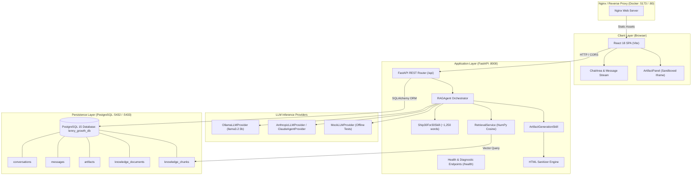
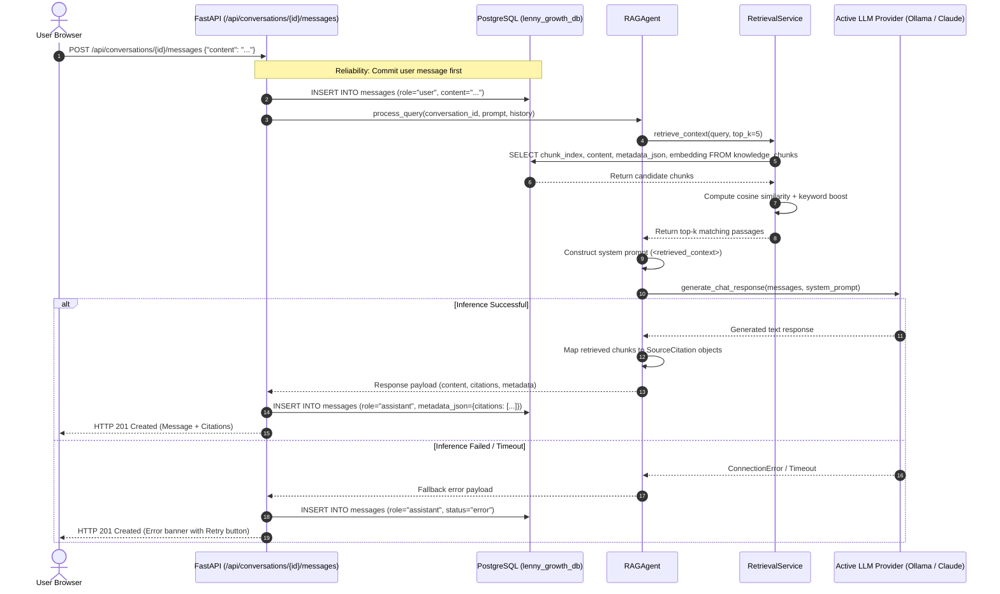
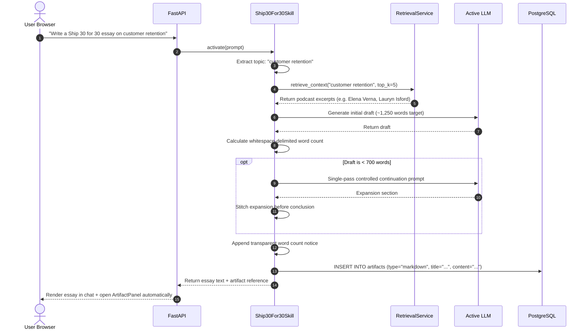
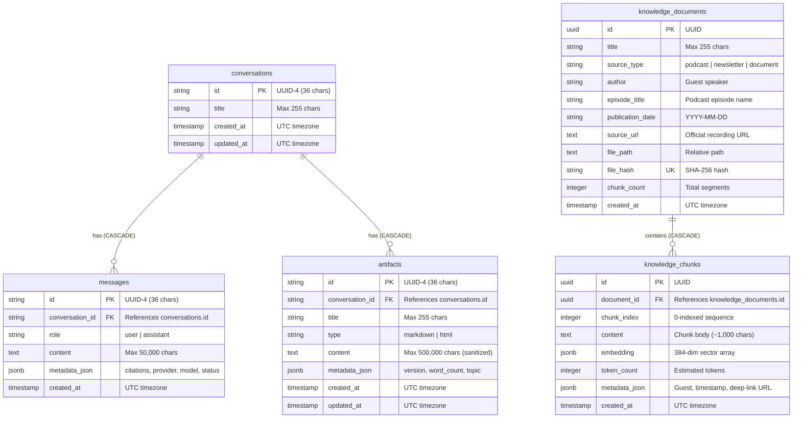
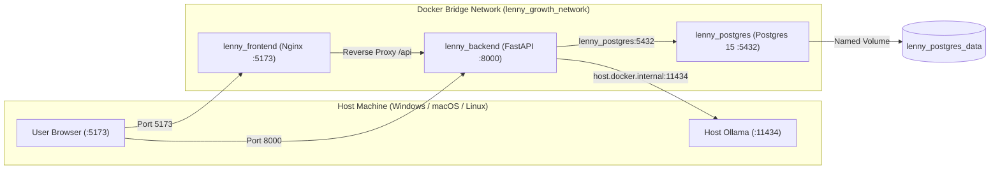

# System Architecture Document

## Project Name: The Lenny Growth Assistant
**Document Version:** 1.0.0  
**Stack:** React (Vite) + FastAPI + PostgreSQL + Ollama / Anthropic Claude  
**Status:** Completed & Production Verified  

---

## 1. High-Level Architectural Overview

The Lenny Growth Assistant is built as a decoupled, service-oriented web application designed for high-signal retrieval, reliable autonomous skills, and secure visual artifact rendering.



---

## 2. Component Responsibilities

### 2.1. Frontend (`frontend/src/`)
- **Framework**: React 18, Vite 5.
- **Components**:
  - `Header.jsx`: Branding, dynamic server status (`Online`), active LLM provider pill (`ollama`, `anthropic`), model name (`llama3.2:3b`).
  - `Sidebar.jsx`: Conversation list, "+ New Chat", conversation deletion with cascade effect.
  - `ChatArea.jsx`: Welcome hero with 4 prompt cards, message feed, citation accordion with clickable YouTube deep links, auto-expanding textarea input.
  - `ArtifactPanel.jsx`: Slide-out studio panel with multi-artifact switcher, `Page Preview` vs `Raw Code` tabs, sandboxed `<iframe>`, copy-to-clipboard, and `.md` / `.html` export.
- **Service Layer (`services/api.js`)**: Clean Axios/Fetch API wrapper handling error recovery, retries, and data transformations.

### 2.2. Backend API (`backend/app/api/`)
- **Framework**: FastAPI (Python 3.10+ / 3.11).
- **Routers**:
  - `conversations.py`: CRUD operations for conversations and message dispatching.
  - `artifacts.py`: CRUD endpoints for artifacts linked to conversations.
  - `health.py`: Liveness (`/health`), DB readiness (`/health/db`), and LLM diagnostics (`/health/llm`).

### 2.3. Agent & Autonomous Skills (`backend/app/agents/` & `backend/app/skills/`)
- **`RAGAgent` (`rag_agent.py`)**: Central agent orchestrator. Ingests user input and chat history, queries `RetrievalService`, constructs untrusted context prompts with anti-injection guards, selects the configured LLM provider, extracts structured source citations, and routes deliverable prompts to specialized skills.
- **`Ship30For30Skill` (`skills/ship_30_for_30.py`)**: Intent-activated skill for ~1,250-word atomic growth essays. Performs topic extraction, injects retrieved podcast wisdom, enforces structural headings, executes single-pass controlled continuation if draft is under 700 words, and reports actual whitespace-delimited word counts.
- **`ArtifactGenerationSkill` (`skills/artifact_generation.py`)**: Synthesizes standalone Markdown guides or HTML/CSS landing pages/widgets, sanitizes them, and records them in PostgreSQL.

### 2.4. Knowledge Base & Vector Retrieval (`backend/app/knowledge_base/`)
- **`loader.py`**: Multi-format loader (`.md`, `.txt`, `.json`, `.pdf`) with canonical path validation preventing path traversal attacks.
- **`normalizer.py`**: Whitespace standardization and speaker turn normalization (`Speaker (HH:MM:SS):`).
- **`chunker.py`**: Configurable sliding window chunker (1,000 characters, 200 overlap).
- **`metadata.py`**: YAML frontmatter parsing (`title`, `guest`, `youtube_url`, `publication_date`) and SHA-256 content hashing.
- **`embeddings.py`**: Embeddings engine supporting `sentence-transformers` (`all-MiniLM-L6-v2`, 384 dims, local cache), lightweight `hash`, local `ollama`, and cloud `openai`.
- **`vector_store.py`**: Storage and retrieval in PostgreSQL with JSONB vector arrays and NumPy cosine similarity.
- **`retrieval.py`**: `RetrievalService` providing clean query search, top-k ranking, guest/episode filtering, and keyword boosting.
- **`ingest.py`**: Repeatable, idempotent CLI ingestion pipeline with progress reporting and duplicate skipping.

---

## 3. Request & Response Execution Flows

### 3.1. Conversational Query & RAG Retrieval Flow



### 3.2. Ship 30 for 30 Essay Generation Flow



---

## 4. API Specification

| Endpoint | Method | Request Body | Response Status | Purpose |
|---|---|---|---|---|
| `/` | `GET` | None | `200 OK` | Root metadata probe and Swagger link |
| `/health` | `GET` | None | `200 OK` | Core service readiness probe |
| `/health/db` | `GET` | None | `200 OK` / `503` | Database connectivity probe (`SELECT 1`) |
| `/health/llm` | `GET` | None | `200 OK` | Diagnostic probe for Ollama / Anthropic status |
| `/api/conversations` | `POST` | `{"title": "..."}` | `201 Created` | Create a new conversation |
| `/api/conversations` | `GET` | None | `200 OK` | List conversations (sorted by `updated_at` desc) |
| `/api/conversations/{id}` | `GET` | None | `200 OK` | Fetch conversation details & full message history |
| `/api/conversations/{id}` | `DELETE` | None | `200 OK` | Delete conversation and cascade delete all messages/artifacts |
| `/api/conversations/{id}/messages` | `POST` | `{"content": "..."}` | `201 Created` | Send message, invoke RAG/Agent, persist assistant reply |
| `/api/conversations/{id}/artifacts`| `POST` | `{"title": "...", "type": "...", "content": "..."}` | `201 Created` | Create and link artifact to conversation |
| `/api/conversations/{id}/artifacts`| `GET` | None | `200 OK` | List all artifacts for a conversation |
| `/api/artifacts/{id}` | `GET` | None | `200 OK` | Retrieve single artifact by ID |
| `/api/artifacts/{id}` | `PUT` | `{"title": "...", "content": "..."}` | `200 OK` | Update artifact content/metadata |
| `/api/artifacts/{id}` | `DELETE` | None | `200 OK` | Delete single artifact by ID |

---

## 5. Database Schema & Relational Models

The database uses PostgreSQL 15 (`lenny_growth_db`). All tables are managed via SQLAlchemy 2.0 ORM models in `backend/app/models/`.



---

## 6. LLM Provider Architecture & Selection Mechanics

All model implementations adhere to the abstract interface `BaseLLMProvider` (`backend/app/agents/base.py`):

```python
class BaseLLMProvider(ABC):
    @property
    @abstractmethod
    def provider_name(self) -> str: pass

    @property
    @abstractmethod
    def model_name(self) -> str: pass

    @abstractmethod
    def generate_chat_response(self, messages, system_prompt=None, temperature=0.7) -> str: pass

    @abstractmethod
    def check_health(self) -> Dict[str, Any]: pass
```

### Supported Providers

1. **`OllamaLLMProvider`** (`app/agents/providers/ollama_provider.py`):
   - Targets local daemon: `http://localhost:11434` (or `http://host.docker.internal:11434` in Docker).
   - Default model: `llama3.2:3b`.
   - Timeout: 60.0s.
   - Bounded retries for transient connection hiccups.
2. **`AnthropicLLMProvider`** (`app/agents/providers/anthropic_provider.py`):
   - Targets cloud Claude API via official `anthropic` SDK.
   - Model: `claude-3-5-sonnet-20241022`.
   - Requires `ANTHROPIC_API_KEY`.
   - Handles 401 auth errors, 429 rate limits, and network dropouts.
3. **`ClaudeAgentProvider`** (`app/agents/providers/claude_agent_provider.py`):
   - Cloud agent framework integration satisfying assignment SDK requirements.
4. **`MockLLMProvider`** (`app/agents/providers/mock_provider.py`):
   - Deterministic, zero-network mock provider used for the 98 hermetic automated tests.

---

## 7. Docker Orchestration & Networking

The system defines 3 containerized services in [`docker-compose.yml`](file:///d:/oogway/lenny%20growth%20assistant/lenny-growth-assistant/docker-compose.yml):



### Networking & Security Hardening
- **Port Mapping**: Container PostgreSQL 5432 maps to host **5433** (`POSTGRES_HOST_PORT`) to eliminate collisions with any local PostgreSQL instance already running on port 5432.
- **Host Gateway**: Backend container uses `host.docker.internal:11434` with Compose `extra_hosts: ["host.docker.internal:host-gateway"]`, providing seamless access to host Ollama across Windows, Mac, and Linux.
- **Non-Root Execution**: Backend Dockerfile creates and executes as an unprivileged user (`appuser`, UID 1000).
- **Readiness Probes**: Backend container employs `wait_for_db()` polling with exponential backoff to eliminate startup race conditions with PostgreSQL.
